# Suspicious PowerShell Detection and Incident Investigation with Microsoft Sentinel

Blue Team lab for detecting suspicious PowerShell execution with Microsoft Sentinel.

The project covers Windows process creation telemetry, KQL detection engineering, positive and negative testing, rule tuning, Sentinel analytics, incident generation, investigation, and response planning.

## Results

| Area | Result |
|---|---|
| Telemetry | Windows Event ID `4688` successfully collected |
| Command-line visibility | Process creation command lines captured in Sentinel |
| Positive detection | PowerShell using `-EncodedCommand` detected |
| Negative/control test | `-NoProfile` without encoded execution no longer alerts after tuning |
| Detection tuning | Broad `NoProfile` condition removed from alert logic |
| Analytics | Scheduled Sentinel analytics rule generated incidents |
| Investigation | Host, user, process, parent process, and command line reviewed |
| MITRE ATT&CK | PowerShell execution mapped to ATT&CK |
| Final classification | Benign Positive — authorized lab activity |

## Detection flow

```text
PowerShell Process Creation
        |
        v
Windows Event ID 4688
        |
        v
Azure Monitor Agent
        |
        v
Log Analytics
        |
        v
KQL Detection
        |
        v
EncodedCommand Match
        |
        v
Microsoft Sentinel Analytics Rule
        |
        v
Incident Investigation
```

## Environment

- Microsoft Azure
- Windows Server 2025
- Microsoft Sentinel
- Log Analytics Workspace
- Azure Monitor Agent
- Data Collection Rule
- Windows Security Event logs
- Kusto Query Language

## Lab architecture

```text
Windows VM
   |
   v
Windows Security Event Logs
   |
   v
Azure Monitor Agent
   |
   v
Data Collection Rule
   |
   v
Log Analytics Workspace
   |
   v
Microsoft Sentinel
   |
   +--> KQL Hunting
   |
   +--> Analytics Rule
   |
   +--> Incident
```

## Windows telemetry configuration

Process Creation auditing was enabled to generate Event ID `4688`.

```powershell
auditpol /set /subcategory:"Process Creation" /success:enable
```

Command-line logging for process creation events was also enabled:

```powershell
reg add "HKLM\Software\Microsoft\Windows\CurrentVersion\Policies\System\Audit" /v ProcessCreationIncludeCmdLine_Enabled /t REG_DWORD /d 1 /f
```

The configuration was verified with:

```powershell
auditpol /get /subcategory:"Process Creation"
```

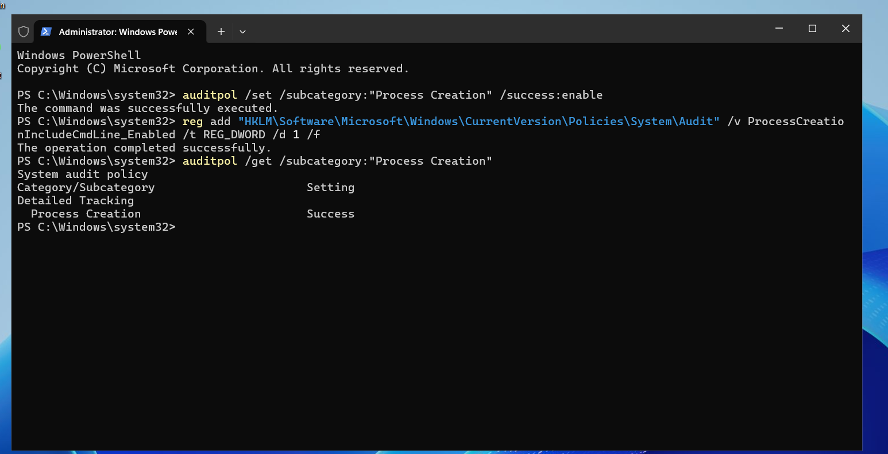

## Controlled PowerShell activity

Two test cases were generated.

### Control case

```powershell
powershell.exe -NoProfile -Command "Get-Process | Select-Object -First 5"
```

This command uses `-NoProfile`, but does not use encoded execution.

### Positive case

```powershell
powershell.exe -NoProfile -EncodedCommand RwBlAHQALQBEAGEAdABlAA==
```

The encoded content decodes to:

```powershell
Get-Date
```

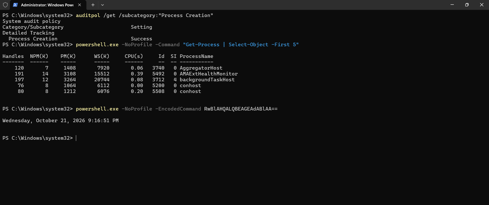

## Initial hunting

Event ID `4688` records process creation.

The initial KQL hunt identified PowerShell process creation events in Sentinel.

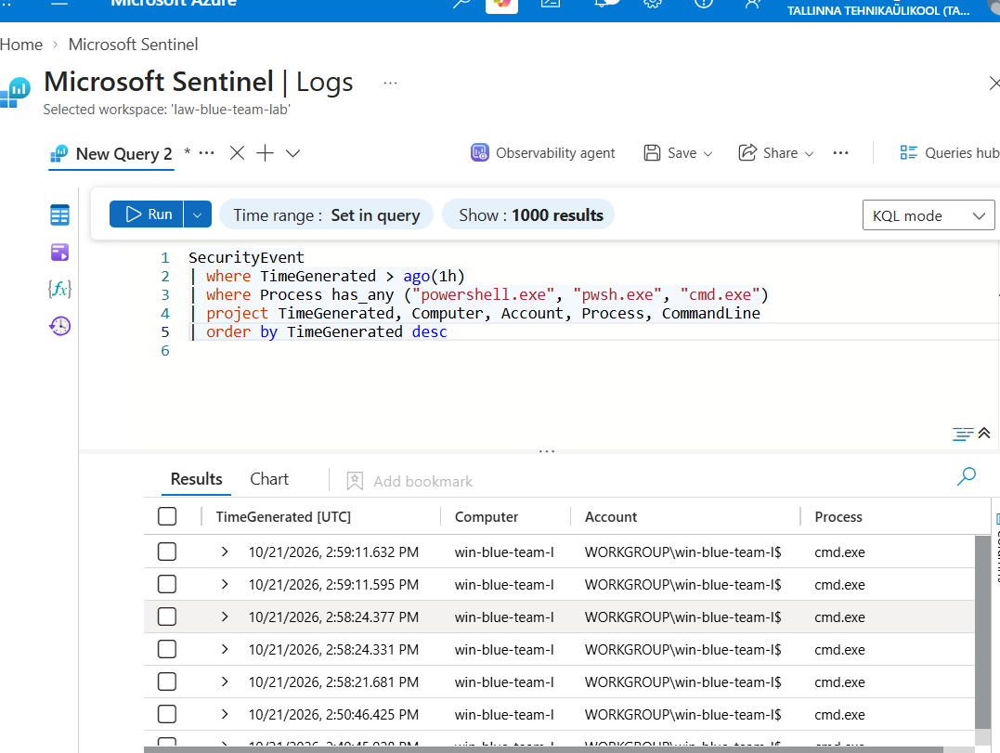

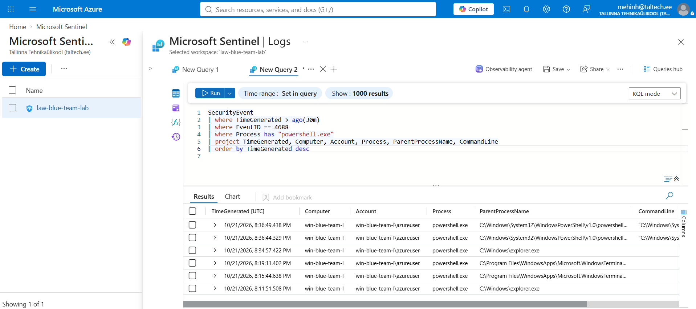

## Detection tuning

The first detection treated both of these as suspicious:

- `-EncodedCommand`
- `-NoProfile`

This was too broad.

`-NoProfile` is commonly used in legitimate administration and scripting, so triggering an alert solely on that argument could generate unnecessary noise.

The rule was tuned so that:

| Test | Before tuning | After tuning |
|---|---|---|
| `-NoProfile` only | Alert | No alert |
| `-EncodedCommand` | Alert | Alert |

`-NoProfile` is still retained as investigation context, but it is no longer sufficient to create a detection.

## Final detection logic

The final query:

- filters for Windows Event ID `4688`;
- identifies `powershell.exe` and `pwsh.exe`;
- normalizes process and command-line values to lowercase;
- detects encoded-command usage;
- records whether `-NoProfile` is also present;
- alerts only when encoded execution is detected.

The complete current query is stored in:

[`queries/powershell-detection.kql`](queries/powershell-detection.kql)

The core classification is:

`Encoded PowerShell command`

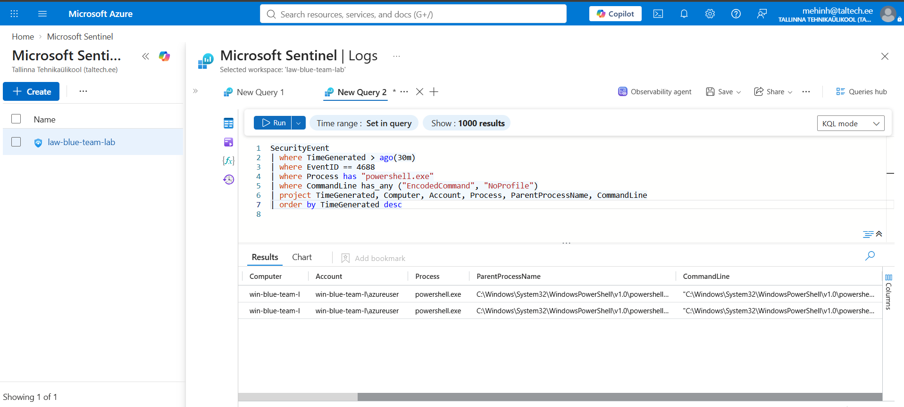

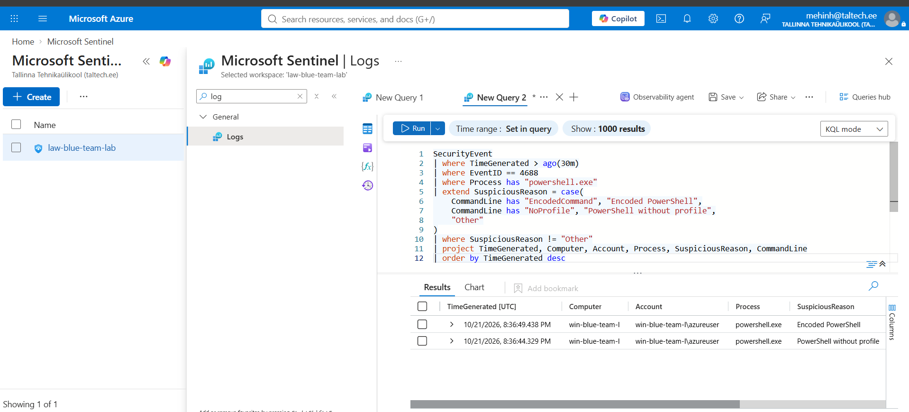

## Microsoft Sentinel analytics rule

The KQL detection was converted into a scheduled Sentinel analytics rule.

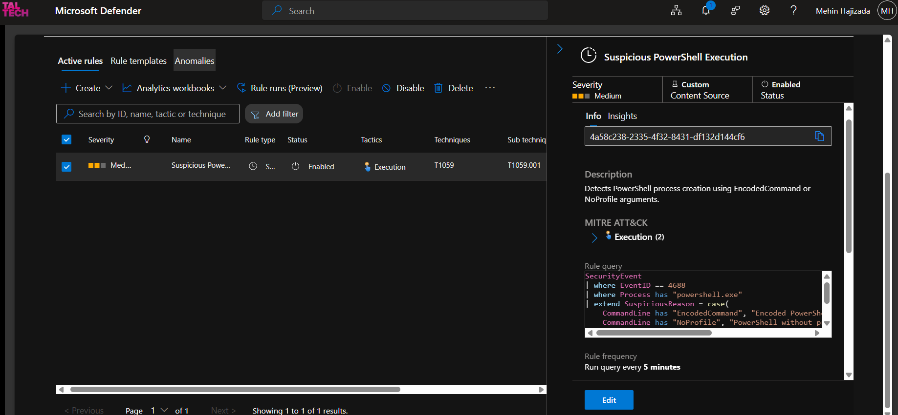

The rule schedule was configured separately.

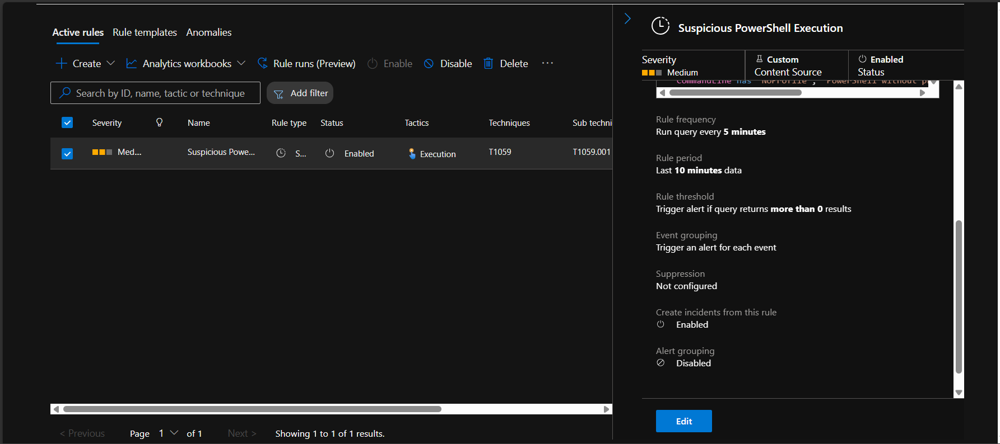

## Incident generation

The controlled encoded PowerShell activity triggered a Microsoft Sentinel incident.

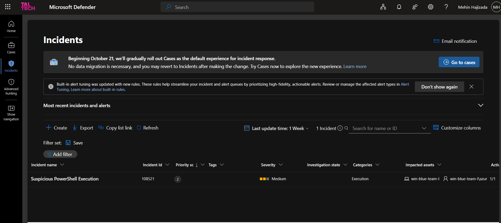

## Incident investigation

The investigation reviewed:

- affected host;
- user account;
- process name;
- parent process;
- command line;
- encoded-command indicator;
- surrounding endpoint activity.

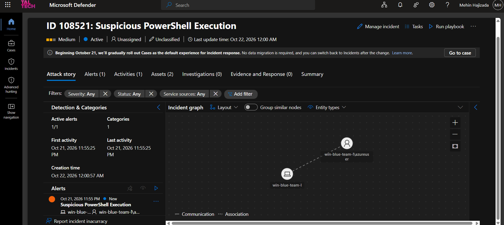

The incident summary captured the controlled activity.

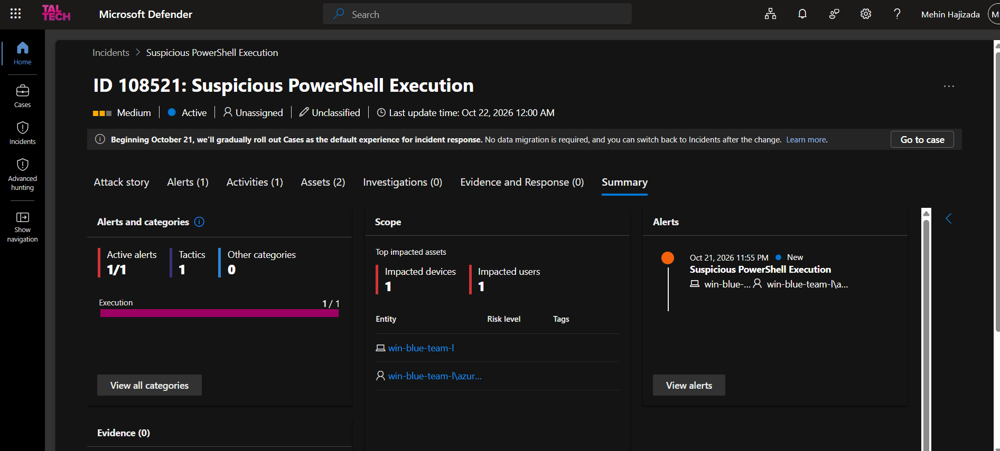

## Analyst assessment

Encoded PowerShell is not automatically malicious, but it increases investigation priority because encoded commands can hide the executed content from casual inspection.

Relevant investigation questions include:

- Who launched PowerShell?
- What was the parent process?
- What does the encoded content decode to?
- Was the execution expected?
- Did the process create files, network connections, or child processes?
- Did the same host show other suspicious behavior?
- Was the account authorized to perform the action?

In this lab, the encoded command decoded to the harmless command:

`Get-Date`

The final classification was therefore:

`Benign Positive — authorized security testing`

## MITRE ATT&CK mapping

The behavior relates to PowerShell execution under:

`T1059.001 — Command and Scripting Interpreter: PowerShell`

The lab demonstrates how PowerShell telemetry can be used for behavioral detection and investigation.

## Detection limitations

The final detection intentionally focuses on encoded PowerShell execution.

Possible legitimate matches include:

- enterprise administration scripts;
- software deployment tooling;
- endpoint-management platforms;
- automation frameworks;
- encoded commands used for operational reasons.

The rule does not automatically prove malicious intent.

A production version could improve precision by adding:

- parent-process context;
- user and host baselines;
- encoded payload decoding;
- known-good administrative exclusions;
- process creation correlation;
- network activity;
- Defender for Endpoint telemetry;
- script block logging;
- PowerShell operational logs;
- signer or executable reputation.

## What changed after testing

| Finding | Change |
|---|---|
| Initial rule alerted on `-NoProfile` | Removed `NoProfile` as a standalone alert condition |
| `NoProfile` still had investigation value | Retained it as contextual output |
| Detection originally focused only on `powershell.exe` | Added support for `pwsh.exe` |
| Case-sensitive comparisons could miss variants | Normalized process and command line values |
| README contained large implementation details | Kept final KQL in a dedicated `.kql` file |
| Control and positive cases were not clearly separated | Added explicit negative/control and positive validation |

## Repository structure

```text
sentinel-powershell-detection-and-response/
├── README.md
├── incident-report.md
├── queries/
│   └── powershell-detection.kql
└── screenshots/
    ├── 01-resource-group-overview.png
    ├── 02-vm-overview.png
    ├── 03-nsg-rdp-restriction.png
    ├── 04-sentinel-workspace-overview.png
    ├── 05-dcr-windows-security-events.png
    ├── 06-securityevent-logs.png
    ├── 07-initial-kql-process-hunt.png
    ├── 08-process-creation-auditing-enabled.png
    ├── 08a-powershell-test-activity.png
    ├── 09-powershell-process-events.png
    ├── 10-suspicious-powershell-hunt.png
    ├── 11-powershell-detection-classification.png
    ├── 12a-analytics-rule-detection-logic.png
    ├── 12b-analytics-rule-scheduling.png
    ├── 13-suspicious-powershell-incident.png
    ├── 14-incident-investigation-view.png
    └── 15-incident-summary.png
```

## Scope

This project was built in a controlled Azure lab.

The PowerShell activity was intentionally generated for defensive testing. The project demonstrates telemetry collection, detection engineering, tuning, and incident investigation.

The rule should be tuned further before production use.
